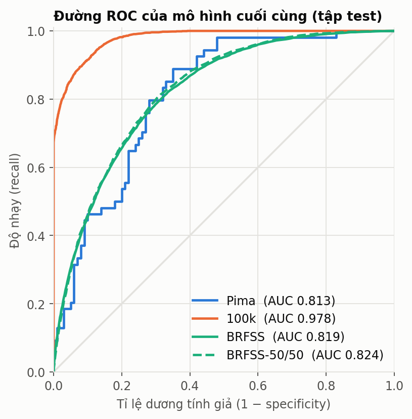
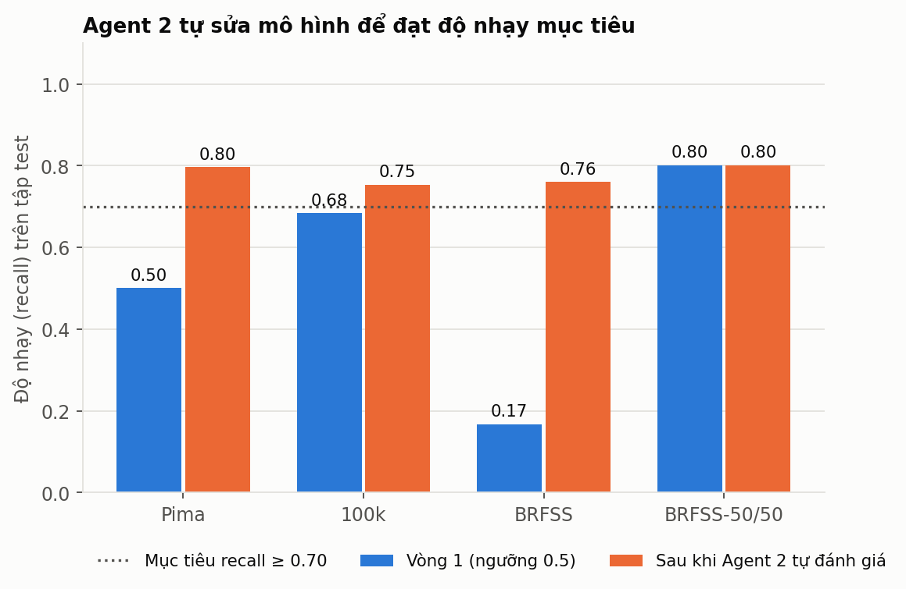
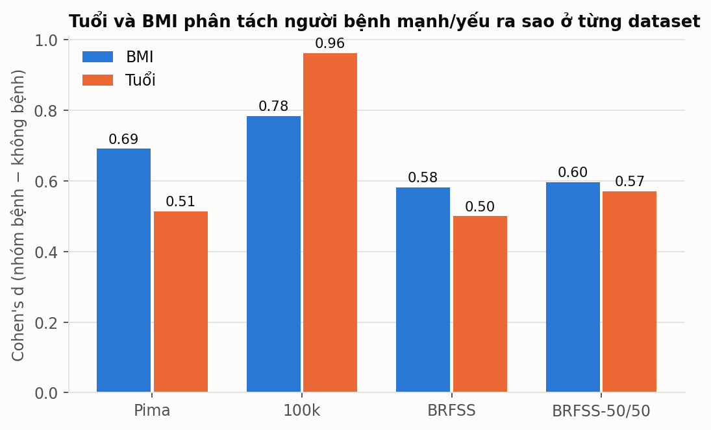
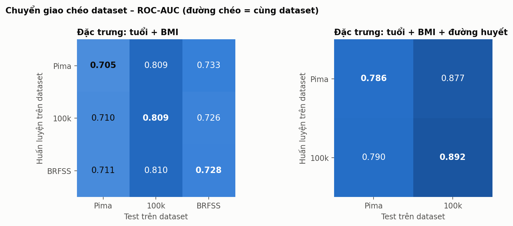
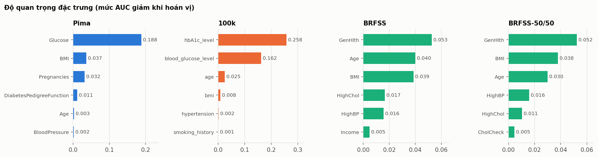
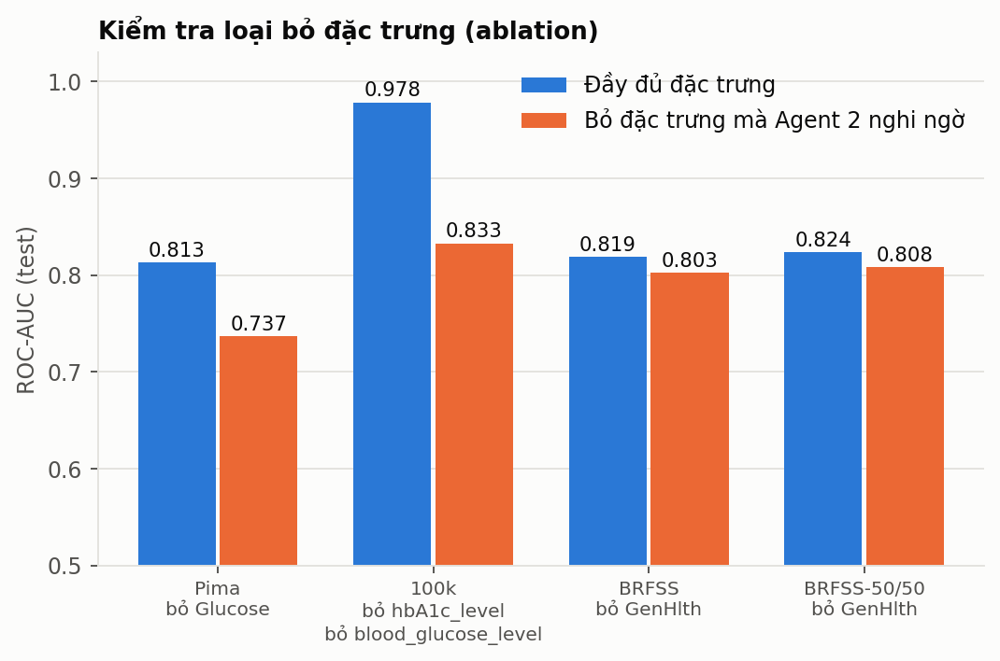

# Hệ đa agent dự đoán bệnh tiểu đường và so sánh 3 bộ dữ liệu

> Báo cáo được **sinh tự động** bởi `ReporterAgent` từ kết quả chạy thật. Toàn bộ quá trình phối hợp giữa các agent (42 message) nằm trong `agent_trace.jsonl`.

## 1. Kiến trúc hệ đa agent

| Agent | Vai trò | Nhận → Gửi |
|---|---|---|
| **Orchestrator** | Điều phối quy trình; quyết định làm lại hay chốt kết quả dựa trên phán quyết của Agent 2 | `data_ready`, `verdict` → `train`, `ablation`, `compare` |
| **DataAgent** | Nạp dữ liệu, phát hiện giá trị thiếu ẩn (số 0 vô lý), bỏ bản ghi trùng lặp, bỏ cột hành chính, chia train/test phân tầng | `prepare` → `data_ready` |
| **ModelAgent** | Huấn luyện 3 mô hình ứng viên (Logistic Regression, Random Forest, Gradient Boosting) bằng CV 5-fold, chọn mô hình tốt nhất, áp dụng chiến lược được yêu cầu (ngưỡng, class_weight, regularize, bỏ đặc trưng) | `train`, `ablation` → `evaluate` |
| **EvaluatorAgent (Agent 2 – tự đánh giá)** | Kiểm tra kết quả theo 9 tiêu chí (AUC, recall, specificity, overfitting, ổn định, nhất quán test–CV, hiệu chuẩn, phụ thuộc đặc trưng, thoái lui); ra phán quyết `ACCEPT / REVISE` và hành động khắc phục | `evaluate` → `verdict` |
| **ComparatorAgent** | So sánh dataset: hiệu năng, đặc trưng chung (tuổi, BMI), chuyển giao chéo, độ quan trọng đặc trưng, ablation | `compare` → `compare_done` |
| **ReporterAgent** | Xuất biểu đồ, bảng và báo cáo này | `report` → `report_done` |

```
Orchestrator ──prepare──▶ DataAgent ──data_ready──▶ Orchestrator
Orchestrator ──train────▶ ModelAgent ──evaluate──▶ EvaluatorAgent (Agent 2)
EvaluatorAgent ──verdict──▶ Orchestrator ──REVISE: train lại (ngưỡng / class_weight / regularize)──▶ ModelAgent
                                         └─ACCEPT: lưu mô hình, (ablation nếu bị nghi ngờ) ─▶ ComparatorAgent ─▶ ReporterAgent
```

**Cơ chế tự đánh giá (vòng lặp):** sau mỗi vòng huấn luyện, Agent 2 chấm điểm kết quả. Nếu có tiêu chí **FAIL** và còn hành động khắc phục, Orchestrator yêu cầu ModelAgent làm lại (tối đa 3 vòng). Vòng cuối được chọn theo thứ tự ưu tiên: ít FAIL → ít WARN → AUC cao. Ngưỡng phân loại chỉ được chọn trên xác suất out-of-fold của **tập train**, tập test không bao giờ được dùng để tinh chỉnh.

## 2. Ba bộ dữ liệu

Bộ dữ liệu thứ 3 là `archive.zip`, chứa 3 file của khảo sát **CDC BRFSS 2015**: `binary` (nhãn 0/1, dùng làm bản chính), `5050split` (tập con cân bằng 50/50, chạy như một biến thể để xem tác động của việc cân bằng lớp) và `012` (nhãn 3 lớp, chỉ để mô tả).

| Dataset | Dòng gốc | Sau làm sạch | Số đặc trưng | Tỉ lệ bệnh (gốc → sau) | Trùng lặp đã bỏ | Số 0 vô lý → thiếu | Cách thu thập |
|---|---|---|---|---|---|---|---|
| **Pima Indians Diabetes** | 768 | 768 | 8 | 34.9% → 34.9% | 0 | 652 | Đo lâm sàng (đường huyết, huyết áp, insulin, độ dày da, BMI) |
| **Diabetes Prediction 100k** | 100,000 | 99,100 | 13 | 8.5% → 8.6% | 900 | 0 | Có xét nghiệm HbA1c + đường huyết, tiền sử tăng huyết áp/tim mạch, hút thuốc |
| **CDC BRFSS 2015 (binary)** | 253,680 | 229,474 | 21 | 13.9% → 15.3% | 24,206 | 0 | Khảo sát điện thoại, tự khai báo (lối sống, bệnh nền, kinh tế - xã hội), KHÔNG có xét nghiệm |
| **CDC BRFSS 2015 (50/50)** | 70,692 | 69,057 | 21 | 50.0% → 50.8% | 1,635 | 0 | Giống BRFSS binary |

| Dataset | Quần thể | Định nghĩa nhãn |
|---|---|---|
| **Pima** | 768 phụ nữ ≥ 21 tuổi thuộc bộ tộc Pima (Mỹ) – dữ liệu lâm sàng của NIDDK | Outcome = 1 là nhãn đái tháo đường của bộ dữ liệu; không suy ra thời điểm chẩn đoán từ CSV |
| **100k** | 100.000 bản ghi, nhiều bang/năm/chủng tộc (phân bố race đều 20% -> dấu hiệu dữ liệu tổng hợp/ghép) | diabetes = 1/0 (gắn với HbA1c và đường huyết) |
| **BRFSS** | 253.680 người trưởng thành Mỹ trả lời khảo sát sức khỏe CDC 2015 | Diabetes_binary = 1 nếu tự khai đã được bác sĩ chẩn đoán đái tháo đường (tiền đái tháo đường -> 0) |
| **BRFSS-50/50** | 70.692 bản ghi – tập con của BRFSS đã cân bằng 50% mắc / 50% không mắc | Giống BRFSS binary nhưng cân bằng lớp (50/50) |

**File `012`**: 0 = 84.2%, 1 (tiền đái tháo đường) = 1.8%, 2 (đái tháo đường) = 13.9%. Đối chiếu từng dòng với file `binary`: nhãn `binary` trùng với `(012 == 2)` ở **100.00%** số dòng (và chỉ 98.17% nếu coi tiền đái tháo đường là 1) – tức là trong bản `binary`, **người tiền đái tháo đường được tính là 0**.

**Lưu ý Pima:** số giá trị 0 *không thể xảy ra về mặt sinh học* (vd. đường huyết = 0): Glucose 5, BloodPressure 35, SkinThickness 227, Insulin 374, BMI 11. Chúng được coi là thiếu và điền trung vị **bên trong pipeline** (chỉ học từ tập train để không rò rỉ).

## 3. Kết quả dự đoán (mô hình cuối, tập test)

| Dataset | Mô hình | ROC-AUC [KTC 95%] | PR-AUC | Recall | Precision | Specificity | F2 | Accuracy | Brier | Ngưỡng | Tỉ lệ bệnh |
|---|---|---|---|---|---|---|---|---|---|---|---|
| **Pima** | Logistic Regression | 0.813 [0.748–0.873] | 0.673 | 0.80 | 0.60 | 0.71 | 0.75 | 0.74 | 0.175 | 0.31 | 34.9% |
| **100k** | Gradient Boosting | 0.978 [0.976–0.981] | 0.886 | 0.75 | 0.84 | 0.99 | 0.77 | 0.97 | 0.023 | 0.28 | 8.6% |
| **BRFSS** | Gradient Boosting | 0.819 [0.815–0.824] | 0.447 | 0.76 | 0.33 | 0.72 | 0.60 | 0.73 | 0.105 | 0.17 | 15.3% |
| **BRFSS-50/50** | Gradient Boosting | 0.824 [0.817–0.831] | 0.802 | 0.80 | 0.73 | 0.70 | 0.79 | 0.75 | 0.170 | 0.50 | 50.8% |



*Precision và PR-AUC phụ thuộc mạnh vào tỉ lệ bệnh của từng dataset (precision ngẫu nhiên = tỉ lệ bệnh), vì vậy chỉ **ROC-AUC** mới so sánh trực tiếp được giữa các dataset.*

<details><summary>Điểm CV của các mô hình ứng viên (vòng được chọn)</summary>

| Dataset | Mô hình | AUC CV (5-fold) | AUC train | Được chọn |
|---|---|---|---|---|
| Pima | Logistic Regression | 0.843 ± 0.019 | 0.851 | ✔ |
| Pima | Random Forest | 0.826 ± 0.025 | 0.999 |  |
| Pima | Gradient Boosting | 0.796 ± 0.022 | 1.000 |  |
| 100k | Logistic Regression | 0.962 ± 0.002 | 0.962 |  |
| 100k | Random Forest | 0.971 ± 0.001 | 0.983 |  |
| 100k | Gradient Boosting | 0.979 ± 0.000 | 0.987 | ✔ |
| BRFSS | Logistic Regression | 0.806 ± 0.001 | 0.808 |  |
| BRFSS | Random Forest | 0.811 ± 0.001 | 0.830 |  |
| BRFSS | Gradient Boosting | 0.815 ± 0.001 | 0.827 | ✔ |
| BRFSS-50/50 | Logistic Regression | 0.820 ± 0.004 | 0.821 |  |
| BRFSS-50/50 | Random Forest | 0.823 ± 0.004 | 0.846 |  |
| BRFSS-50/50 | Gradient Boosting | 0.825 ± 0.004 | 0.841 | ✔ |

</details>

## 4. Agent 2 – Tự đánh giá



### Pima Indians Diabetes

| Vòng | Chiến lược | Mô hình | AUC | Recall | Precision | Specificity | Phán quyết |
|---|---|---|---|---|---|---|---|
| 1 | ngưỡng 0.5 | Logistic Regression | 0.813 | 0.50 | 0.60 | 0.82 | REVISE (FAIL 1, WARN 3) |
| 2 | ngưỡng tối ưu từ OOF (recall ≥ 0.75) | Logistic Regression | 0.813 | 0.80 | 0.60 | 0.71 | ACCEPT (FAIL 0, WARN 3) ⬅ chọn |

Chi tiết các tiêu chí ở vòng được chọn:

|  | Tiêu chí | Chi tiết |
|---|---|---|
| ✅ | Phân biệt (AUC test) | AUC = 0.813 (yêu cầu ≥ 0.75) |
| ✅ | Độ nhạy (recall) | recall = 0.80 (yêu cầu ≥ 0.7) |
| ✅ | Độ đặc hiệu (specificity) | specificity = 0.71 (yêu cầu ≥ 0.5); precision = 0.60 |
| ✅ | Overfitting (AUC train − CV) | chênh lệch = 0.008 |
| ✅ | Ổn định giữa các fold | độ lệch chuẩn AUC CV = 0.019 (≤ 0.03) |
| ⚠️ | Nhất quán test ↔ CV | |AUC test − AUC CV| = 0.030; khoảng tin cậy 95% của AUC test = [0.748, 0.873] |
| ⚠️ | Hiệu chuẩn xác suất (ECE) | ECE = 0.110 (≤ 0.05); Brier = 0.175 |
| ⚠️ | Phụ thuộc đặc trưng | AUC tụt mạnh khi hoán vị: Glucose (−0.188) -> sẽ chạy kiểm tra loại bỏ (ablation) |
| ✅ | Thoái lui so với vòng trước | AUC vòng trước 0.813 -> 0.813 |

### Diabetes Prediction 100k

| Vòng | Chiến lược | Mô hình | AUC | Recall | Precision | Specificity | Phán quyết |
|---|---|---|---|---|---|---|---|
| 1 | ngưỡng 0.5 | Gradient Boosting | 0.978 | 0.68 | 0.98 | 1.00 | REVISE (FAIL 1, WARN 1) |
| 2 | ngưỡng tối ưu từ OOF (recall ≥ 0.75) | Gradient Boosting | 0.978 | 0.75 | 0.84 | 0.99 | ACCEPT (FAIL 0, WARN 1) ⬅ chọn |

Chi tiết các tiêu chí ở vòng được chọn:

|  | Tiêu chí | Chi tiết |
|---|---|---|
| ✅ | Phân biệt (AUC test) | AUC = 0.978 (yêu cầu ≥ 0.75) |
| ✅ | Độ nhạy (recall) | recall = 0.75 (yêu cầu ≥ 0.7) |
| ✅ | Độ đặc hiệu (specificity) | specificity = 0.99 (yêu cầu ≥ 0.5); precision = 0.84 |
| ✅ | Overfitting (AUC train − CV) | chênh lệch = 0.008 |
| ✅ | Ổn định giữa các fold | độ lệch chuẩn AUC CV = 0.000 (≤ 0.03) |
| ✅ | Nhất quán test ↔ CV | |AUC test − AUC CV| = 0.000; khoảng tin cậy 95% của AUC test = [0.976, 0.981] |
| ✅ | Hiệu chuẩn xác suất (ECE) | ECE = 0.003 (≤ 0.05); Brier = 0.023 |
| ⚠️ | Phụ thuộc đặc trưng | AUC tụt mạnh khi hoán vị: hbA1c_level (−0.258), blood_glucose_level (−0.162) -> sẽ chạy kiểm tra loại bỏ (ablation) |
| ✅ | Thoái lui so với vòng trước | AUC vòng trước 0.978 -> 0.978 |

### CDC BRFSS 2015 (binary)

| Vòng | Chiến lược | Mô hình | AUC | Recall | Precision | Specificity | Phán quyết |
|---|---|---|---|---|---|---|---|
| 1 | ngưỡng 0.5 | Gradient Boosting | 0.819 | 0.17 | 0.60 | 0.98 | REVISE (FAIL 1, WARN 1) |
| 2 | ngưỡng tối ưu từ OOF (recall ≥ 0.75) | Gradient Boosting | 0.819 | 0.76 | 0.33 | 0.72 | ACCEPT (FAIL 0, WARN 1) ⬅ chọn |

Chi tiết các tiêu chí ở vòng được chọn:

|  | Tiêu chí | Chi tiết |
|---|---|---|
| ✅ | Phân biệt (AUC test) | AUC = 0.819 (yêu cầu ≥ 0.75) |
| ✅ | Độ nhạy (recall) | recall = 0.76 (yêu cầu ≥ 0.7) |
| ✅ | Độ đặc hiệu (specificity) | specificity = 0.72 (yêu cầu ≥ 0.5); precision = 0.33 |
| ✅ | Overfitting (AUC train − CV) | chênh lệch = 0.012 |
| ✅ | Ổn định giữa các fold | độ lệch chuẩn AUC CV = 0.001 (≤ 0.03) |
| ✅ | Nhất quán test ↔ CV | |AUC test − AUC CV| = 0.004; khoảng tin cậy 95% của AUC test = [0.815, 0.824] |
| ✅ | Hiệu chuẩn xác suất (ECE) | ECE = 0.004 (≤ 0.05); Brier = 0.105 |
| ⚠️ | Phụ thuộc đặc trưng | AUC tụt mạnh khi hoán vị: GenHlth (−0.053) -> sẽ chạy kiểm tra loại bỏ (ablation) |
| ✅ | Thoái lui so với vòng trước | AUC vòng trước 0.819 -> 0.819 |

### CDC BRFSS 2015 (50/50)

| Vòng | Chiến lược | Mô hình | AUC | Recall | Precision | Specificity | Phán quyết |
|---|---|---|---|---|---|---|---|
| 1 | ngưỡng 0.5 | Gradient Boosting | 0.824 | 0.80 | 0.73 | 0.70 | ACCEPT (FAIL 0, WARN 1) ⬅ chọn |

Chi tiết các tiêu chí ở vòng được chọn:

|  | Tiêu chí | Chi tiết |
|---|---|---|
| ✅ | Phân biệt (AUC test) | AUC = 0.824 (yêu cầu ≥ 0.75) |
| ✅ | Độ nhạy (recall) | recall = 0.80 (yêu cầu ≥ 0.7) |
| ✅ | Độ đặc hiệu (specificity) | specificity = 0.70 (yêu cầu ≥ 0.5); precision = 0.73 |
| ✅ | Overfitting (AUC train − CV) | chênh lệch = 0.016 |
| ✅ | Ổn định giữa các fold | độ lệch chuẩn AUC CV = 0.004 (≤ 0.03) |
| ✅ | Nhất quán test ↔ CV | |AUC test − AUC CV| = 0.002; khoảng tin cậy 95% của AUC test = [0.817, 0.831] |
| ✅ | Hiệu chuẩn xác suất (ECE) | ECE = 0.009 (≤ 0.05); Brier = 0.170 |
| ⚠️ | Phụ thuộc đặc trưng | AUC tụt mạnh khi hoán vị: GenHlth (−0.052) -> sẽ chạy kiểm tra loại bỏ (ablation) |

## 5. So sánh sự khác biệt giữa các dataset

### 5.1 Khác biệt về bản chất dữ liệu

| Khía cạnh | Pima | 100k | BRFSS |
|---|---|---|---|
| Quy mô | 768 | 99,100 | 229,474 |
| Tỉ lệ bệnh | 34.9% | 8.6% | 15.3% |
| Loại đặc trưng | Chỉ số lâm sàng/xét nghiệm (đường huyết, insulin, huyết áp…), tiền sử gia đình, số lần mang thai | Xét nghiệm HbA1c + đường huyết, BMI, tuổi, bệnh nền, hút thuốc, giới, chủng tộc | Hành vi & tự khai: huyết áp/mỡ máu cao, vận động, ăn rau quả, sức khỏe tự đánh giá, thu nhập, học vấn… |
| Có xét nghiệm? | Có | Có (HbA1c, đường huyết) | Không – hoàn toàn tự khai |
| Quần thể | Chỉ nữ, một nhóm dân tộc | Hỗn hợp, nghi tổng hợp | Người trưởng thành Mỹ, đại diện quốc gia |
| Mã hóa tuổi | Số năm | Số năm | 13 nhóm tuổi |

### 5.2 Đặc trưng chung: tuổi & BMI

| Dataset | Tuổi (không bệnh → bệnh) | Cohen's d tuổi | AUC đơn lẻ (tuổi) | BMI (không bệnh → bệnh) | Cohen's d BMI | AUC đơn lẻ (BMI) |
|---|---|---|---|---|---|---|
| Pima | 31.2 → 37.1 | 0.51 | 0.687 | 30.9 → 35.4 | 0.69 | 0.686 |
| 100k | 40.1 → 60.9 | 0.96 | 0.772 | 26.9 → 32.0 | 0.78 | 0.705 |
| BRFSS | 56.2 → 63.9 | 0.50 | 0.640 | 28.1 → 32.0 | 0.58 | 0.675 |
| BRFSS-50/50 | 56.0 → 63.9 | 0.57 | 0.647 | 27.9 → 32.0 | 0.60 | 0.684 |



*BRFSS: tuổi được quy về trung điểm của nhóm tuổi.*

### 5.3 Chuyển giao chéo dataset

Huấn luyện Logistic Regression trên dataset A rồi kiểm tra trên tập test của dataset B, chỉ dùng các đặc trưng có ở cả hai bên. Nếu AUC chéo thấp hơn nhiều so với đường chéo chính, các dataset mô tả những quần thể/nhãn khác nhau.



Với tuổi + BMI: AUC trung bình cùng dataset **0.748**, khác dataset **0.750**.
 Với thêm đường huyết (chỉ Pima ↔ 100k): Pima→100k = 0.877, 100k→Pima = 0.790 (lưu ý: đường huyết ở Pima đo sau nghiệm pháp dung nạp glucose, ở 100k là đường huyết thông thường – cùng đơn vị mg/dL nhưng khác ý nghĩa).


### 5.4 Yếu tố nào quyết định dự đoán ở từng dataset



- **Pima**: `Glucose` (−0.188), `BMI` (−0.037), `Pregnancies` (−0.032)
- **100k**: `hbA1c_level` (−0.258), `blood_glucose_level` (−0.162), `age` (−0.025)
- **BRFSS**: `GenHlth` (−0.053), `Age` (−0.040), `BMI` (−0.039)
- **BRFSS-50/50**: `GenHlth` (−0.052), `BMI` (−0.038), `Age` (−0.030)

### 5.5 Kiểm tra loại bỏ đặc trưng (do Agent 2 yêu cầu)

| Dataset | Đặc trưng bị bỏ | AUC đầy đủ → sau khi bỏ | PR-AUC đầy đủ → sau khi bỏ |
|---|---|---|---|
| Pima | `Glucose` | 0.813 → 0.737 | 0.673 → 0.546 |
| 100k | `hbA1c_level`, `blood_glucose_level` | 0.978 → 0.833 | 0.886 → 0.322 |
| BRFSS | `GenHlth` | 0.819 → 0.803 | 0.447 → 0.420 |
| BRFSS-50/50 | `GenHlth` | 0.824 → 0.808 | 0.802 → 0.788 |



### 5.6 BRFSS tự nhiên vs BRFSS cân bằng 50/50

|  | BRFSS (tự nhiên) | BRFSS 50/50 |
|---|---|---|
| Tỉ lệ bệnh | 15.3% | 50.8% |
| ROC-AUC | 0.819 | 0.824 |
| Recall / Precision (mô hình cuối) | 0.76 / 0.33 | 0.80 / 0.73 |
| Recall / Precision ở ngưỡng 0.5 | 0.17 / 0.60 | 0.80 / 0.73 |
| Accuracy | 0.73 | 0.75 |

## 6. Nhận xét và kết luận

**Điểm chính (rút ra từ số liệu ở trên):**

1. Xếp hạng ROC-AUC: **100k** (0.978) > **BRFSS** (0.819) > **Pima** (0.813).
2. **100k** đạt AUC cao nhất vì có xét nghiệm trực tiếp: khi Agent 2 phát hiện mô hình phụ thuộc vào hbA1c_level, blood_glucose_level và loại chúng ra, AUC giảm từ 0.978 xuống 0.833. PR-AUC còn tụt mạnh hơn (0.886 → 0.322). Nghĩa là phần lớn chất lượng dự đoán đến từ hai chỉ số xét nghiệm, chứ không phải từ các yếu tố nguy cơ (tuổi, BMI, bệnh nền) – tức là mô hình "chẩn đoán" nhiều hơn là "dự báo sớm".
3. **Pima** cũng phụ thuộc vào Glucose: bỏ đi thì AUC từ 0.813 còn 0.737. Tập test chỉ có 154 mẫu nên khoảng tin cậy AUC rộng (0.75–0.87).
4. **BRFSS** không có xét nghiệm nên AUC chỉ 0.819; vì bệnh hiếm (15.3%) nên ở độ nhạy 0.76 thì precision chỉ 0.33 (ngẫu nhiên là 15.3%). Ở ngưỡng 0.5 mô hình chỉ bắt được 17% người bệnh – đây chính là lỗi mà Agent 2 phát hiện và sửa bằng cách hạ ngưỡng. Đổi lại, đây là mô hình duy nhất có thể dùng khi *không có xét nghiệm nào*, vd. sàng lọc qua bảng hỏi.
5. Cân bằng lớp (50/50) gần như không đổi ROC-AUC (0.819 vs 0.824) nhưng làm accuracy/precision "đẹp" lên chỉ vì tỉ lệ bệnh nhân tạo – không được dùng các con số này để ước lượng hiệu quả ngoài đời thật.
6. Chuyển giao chéo chỉ với tuổi + BMI: AUC cùng dataset 0.748 và khác dataset 0.750 gần như bằng nhau – mối liên hệ tuổi/BMI → bệnh khá ổn định giữa các nguồn, và AUC phụ thuộc vào dataset *được kiểm tra* nhiều hơn dataset huấn luyện (vd. 100k dễ hơn vì chênh lệch tuổi giữa hai nhóm rất lớn, Cohen's d = 0.96). Sự khác biệt thật sự giữa các dataset nằm ở các đặc trưng *riêng* (xét nghiệm vs tự khai). AUC chỉ đo thứ hạng nên không phát hiện được việc xác suất tuyệt đối bị lệch khi đổi quần thể (tỉ lệ bệnh 8.6% / 15.3% / 34.9%).

**Hạn chế cần nêu trong tiểu luận:**

- Đây là mô hình nghiên cứu, **không phải công cụ chẩn đoán**. Dữ liệu BRFSS là tự khai; Pima chỉ gồm nữ một nhóm dân tộc; 100k có dấu hiệu dữ liệu tổng hợp (các nhóm chủng tộc đều đúng 20%, ~80% bản ghi cùng một năm).
- Nhãn ở 3 dataset **không cùng nghĩa** (Pima: chẩn đoán trong 5 năm; BRFSS: bác sĩ từng chẩn đoán, tiền đái tháo đường tính là 0), và tập đặc trưng khác nhau, nên AUC giữa các dataset chỉ mang tính tham khảo.
- Bản ghi trùng lặp bị loại trước khi chia train/test để tránh rò rỉ; điều này làm tỉ lệ bệnh của BRFSS thay đổi nhẹ so với bản gốc. Với dữ liệu khảo sát toàn là biến rời rạc, một số trùng lặp là ngẫu nhiên hợp lệ.
- Các agent ở đây là agent dựa trên luật + học máy (không dùng LLM). Hướng mở rộng: thêm một agent LLM diễn giải kết quả cho bác sĩ, agent hiệu chuẩn xác suất, agent công bằng (fairness) theo giới/chủng tộc.

## 7. Cách chạy lại

```bash
pip install -r requirements.txt
python main.py            # chạy đầy đủ (vài phút - chục phút)
python main.py --fast      # chạy thử nhanh trên mẫu nhỏ
python make_report.py      # dựng lại báo cáo/biểu đồ từ outputs/results.json
python predict.py --input examples/patient_example.json
```
